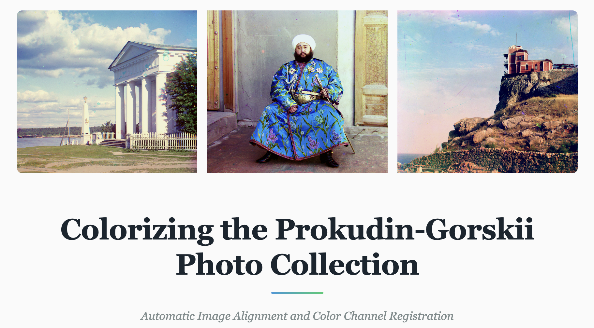

# Prokudin-Gorskii Colorization



Automatic alignment and colorization of Sergei Mikhailovich Prokudin-Gorskii's glass plate photographs from the early 1900s. This project implements single-scale and multi-scale pyramid image alignment algorithms to produce vibrant color images from separate RGB channel exposures.

---

## Overview

This implementation takes digitized Prokudin-Gorskii glass plate images (with stacked B, G, R channels) and automatically aligns them to produce a single color photograph. The algorithm uses:

- **Single-scale exhaustive search** for small JPEG images
- **Multi-scale pyramid alignment** for large TIFF images
- **NCC (Normalized Cross-Correlation) and L2 Norm (Euclidean Distance)** similarity metrics
- **Edge-based features** for challenging cases with automatic fallback

**Key Features:**
- Coarse-to-fine pyramid search for speedup
- Automatic image enhancements (contrast, white balance, color correction)
- Edge-based alignment fallback for poor NCC scores
- Configurable alignment parameters

---

## Directory Structure
```

├── webpage.pdf              # PDF version of webpage
├── code/
│   ├── main.ipynb           # code
│   ├── environment.yml      # dependencies
│   ├── data/                # input images
│   │   ├── cathedral.jpg
│   │   ├── church.tif
│   │   ├── monument.tif
│   │   └── ...
│   └── out/                 # generated output images
└── web/
    ├── index.html           # project webpage
    └── assets/              # web assets
        └── ...
```

---

## Setup

### Installation

**Create conda virtual environment. The environment name is defined as `cv` inside `environment.yml`**:
```bash
conda env create -f environment.yml
conda activate cv
```
---

## Data Setup

### 1. Input Images
Place the provided dataset images from [data.zip](https://drive.google.com/file/d/1nYdWKBnqxFmvB_DXE-giQEjwvBfPH2Ks/view?usp=share_link) in the `data/` directory:
```bash
# Extract data from data.zip
unzip data.zip -d data/
```

### 2. Additional Images
Download the following 3 additional images from the [Prokudin-Gorskii Collection](https://www.loc.gov/collections/prokudin-gorskii/):

**Chosen images:**
- [Monument](https://www.loc.gov/item/2018679151/) 
- [Woods](https://www.loc.gov/item/2018679107/)
- [Railtrack](https://www.loc.gov/item/2018679549/) 

**Download instructions:**
1. Visit the Library of Congress link
2. Select TIFF format from the Download dropdown
3. Save to `code/data/` directory
4. Rename to `monument.tif`, `woods.tif`, `railtrack.tif`

### 3. Web assets
Extract `assets.zip` to get the folder with web assets.
---

## Usage

### Run code

Run the cells in `main.ipynb`. The code uses relative paths. Add the base directory path if required.

The code performs the following:
- Process all image files in `data/`
- Automatically use pyramid alignment
- Apply automatic enhancements (contrast, white balance, color correction)
- Save colorized results to `out/` directory
- Display alignment offsets for each image

### Output

Results are saved as:
```
out/
├── simple_aligned_cathedral.jpg
├── pyramid_aligned_cathedral.jpg
├── pyramid_aligned_church.jpg
├── pyramid_aligned_emir.jpg
└── ...
```

---

## Code Structure

### Main Classes

#### `Image`
Interface for loading and processing images.
```python
image = Image(impath, metric='ncc', use_pyramid=True, auto_contrast=True, auto_white_balance=True, auto_color_correction=True)
image.save_image('out/result.jpg')
```

**Parameters:**
- `impath`: str - Path to input image
- `metric`: str - Alignment metric (`'ncc'` or `'l2norm'`)
- `use_pyramid`: bool - Use pyramid alignment (`True` or `False`)

#### `Alignment`
Core alignment algorithm implementation.

**Key Parameters:**
- `max_shift`: Maximum search displacement (default: 50 pixels)
- `refine_range`: Refinement window in pyramid (default: 3 pixels)
- `max_levels`: Maximum pyramid levels (default: 6)
- `min_size`: Minimum image dimension at coarsest level (default: 50px)

#### `ImageEnhancer`
Post-processing enhancements.

**Features:**
- Automatic contrast enhancement
- Automatic white balance
- Adaptive color correction

### Key Methods

- `simple_align()`: Single-scale exhaustive search
- `pyramid_search()`: Recursive coarse-to-fine alignment
- `align_channel()`: Align one channel to reference with automatic edge fallback
- `get_edges()`: Sobel edge detection for challenging images
- `enhance()`: Apply automatic enhancements
---

## Results

- Single-scale alignment results on JPEG images
- Pyramid alignment results on all images  
- Computed displacement offsets for all images
- Before/after comparisons for all enhancements